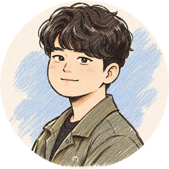

<p align="center">
  
</p>
<h2 align="center">JongBeom Park (박종범)</h2>
<p align="center">AI Platform Engineer · LLM Serving &amp; Inference Infra</p>
<p align="center">
  <a href="mailto:dismas5184@gmail.com"></a>
  <a href="https://www.linkedin.com/in/dismas5184"></a>
</p>

```yaml
whoami: AI Platform Engineer
company: ezCaretech · AI Team (2024.12 ~)
focus: [LLM Serving, Inference Infra, Agent Workload]
now:
  - Benchmarking local LLM serving with vLLM
oss:
  huggingface/transformers: Korean docs translation · merged 2025.07
certs:
  CKA: The Linux Foundation · 2026.05 (~2028.05)
  빅데이터분석기사: Bigdata Analysis Engineer · Korea Data Agency · 2026.07
  AICE Associate: KT · 2026.06 (~2029.06)
  정보처리기사: Engineer Information Processing · HRD Korea · 2024.04
  SQLD: SQL Developer · Korea Data Agency · 2024.09
  OPIc: IH · ACTFL · 2026.09
education: B.S. Computer Engineering (Big Data Track) · Hansung University
```

<p align="center">
  
  
  
  
  <a href="https://www.credly.com/badges/29458e4e-3319-45d6-bcc9-c375d8b284b3/public_url"></a>
</p>
